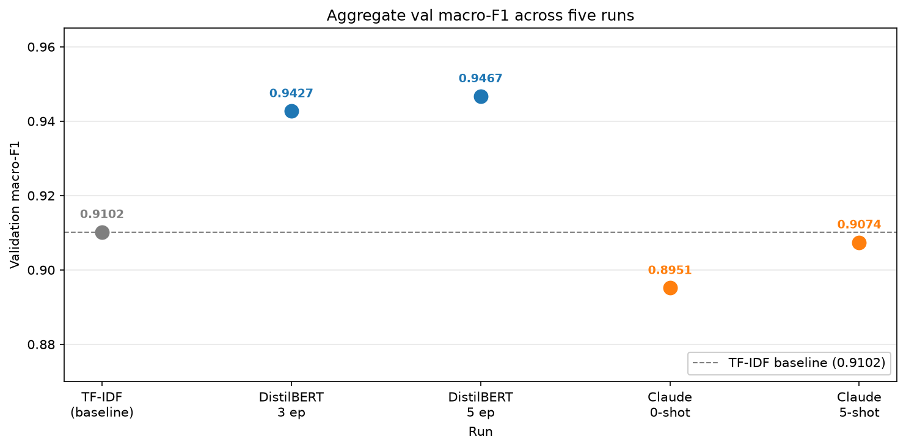
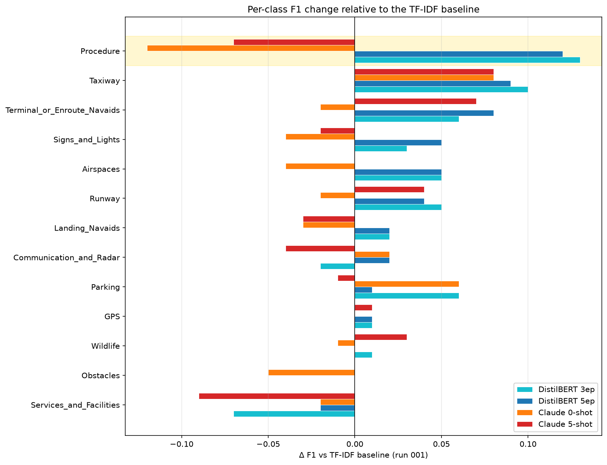

# NOTAM Classifier

Multi-class classification of aviation NOTAMs into 13 operational categories.
The long-term goal is a NOTAM assistant that both classifies and summarizes
NOTAMs in plain English; this repository currently implements v1 (classification).

## Problem

Given a raw NOTAM (Notice to Airmen) — a short, telegraphic, safety-critical
message announcing a temporary change at an airport or in airspace — predict
which of 13 operational categories it belongs to.

Automating that label assignment lets downstream systems (flight planning, ATC
tools, dispatch dashboards) filter and prioritize messages, route each notice
to the right operational team (runway maintenance, flight planning, crew
briefing), and analyze NOTAM trends. Today the labeling is done by hand or by
crude keyword matching.

A representative example:

    Input (text):   "ILS GP 24R U/S"
    Output (class): Landing_Navaids (3)

The labels follow the DEEL-AI NOTAM taxonomy, which covers airspace, navaids,
obstacles, runway state, wildlife, and related aviation-safety categories.

## Approach

**Data.** The [DEEL-AI/NOTAM](https://huggingface.co/datasets/DEEL-AI/NOTAM)
dataset on Hugging Face: 8,478 real NOTAMs, expert-labeled into 13 classes,
provided as 4,237 train / 4,241 test. The test split is never touched during
experimentation.

**Split.** The DEEL-AI train split is stratified 80/20 into new train (~3,390
rows) and validation (~848 rows). Stratification by label preserves class
distribution across the split. Test (4,241 rows) is held out and touched
exactly once for final evaluation.

**Baselines first.** Two baselines, established before any transformer work:
a majority-class floor and TF-IDF + Logistic Regression. Anything more
complex has to beat them, on validation only.

**Model scope (v1).** Three approaches, each a controlled experiment:
1. TF-IDF + Logistic Regression (baseline)
2. Fine-tuned DistilBERT (main experiment; first hands-on transformer work)
3. Zero-shot LLM classification (comparison; tests whether a general-purpose
   model can handle the compressed NOTAM dialect without fine-tuning)

**Not in v1.** Summarization (v2), retrieval, or any interactive assistant
layer. Classification only.

## Findings

### Results across five experiments
Three model families were compared on the same validation split (848 examples)
against the primary target: does a model recover the hard classes, in
particular Procedure?

| Class | TF-IDF + LR | DistilBERT 3ep | DistilBERT 5ep | Claude 0-shot | Claude 5-shot |
|---|---|---|---|---|---|
| **Aggregate macro-F1** | **0.9102** | **0.9427** | **0.9467** | **0.8951** | **0.9074** |
| Procedure | 0.78 | 0.91 | 0.90 | 0.66 | 0.71 |
| Communication_and_Radar | 0.87 | 0.85 | 0.89 | 0.89 | 0.83 |
| Parking | 0.88 | 0.94 | 0.89 | 0.94 | 0.87 |
| Taxiway | 0.88 | 0.98 | 0.97 | 0.96 | 0.96 |
| Signs_and_Lights | 0.90 | 0.93 | 0.95 | 0.86 | 0.88 |



### Fine-tuning closes the Procedure gap that vocabulary cannot

TF-IDF + Logistic Regression saturates at 0.9102 aggregate: 10 of 13 classes
reach F1 ≥ 0.90 because class-conditional vocabulary is close to a signature.
The residual difficulty concentrates in **Procedure**, which shares tokens with
Landing_Navaids ("ILS GP U/S" can be a navaid outage or an approach-procedure
instruction). Fine-tuning DistilBERT lifts Procedure from 0.78 → 0.91 on validation 
— ~13 points, well outside validation noise — and from 0.84 → 0.88 on the held-out 
test set, where the TF-IDF baseline turned out to perform better than the small val 
slice suggested (see Test-set evaluation below). The real-world lift is ~4 points, 
meaningful but more modest than val alone implied. The mechanism remains clause-level 
context: self-attention can condition on phrases like ‘APCH SHOULD NOT BE FLOWN’ that 
a bag-of-words model structurally cannot use.



### Zero-shot LLM classification underperforms even a bag-of-words baseline

Claude (zero-shot, class names as the only context) scores **0.8951 aggregate**
— below TF-IDF (0.9102) and 5 points below DistilBERT (0.9467). More
importantly, **Procedure drops to 0.66**, 12 points *below* TF-IDF and 25 points
below DistilBERT, with zero parse failures. The LLM does not fail on
tokenization or output parsing; it fails because "Procedure" without the
DEEL-AI definition is a generic English word (a documented sequence of steps),
not an aviation operational-instruction class. The model applies the wrong
prior.

The failure is class-specific, not global. On **Communication_and_Radar (0.89),
Parking (0.94), and Taxiway (0.96)** the LLM matches or beats both baselines —
classes whose names carry their domain content directly. It fails specifically
on classes whose names require a domain-specific definition to interpret
correctly. Different model families also fail differently: on Signs_and_Lights
the LLM's precision is 1.00 but recall 0.76 (conservative — never mislabels
something as Signs_and_Lights but misses a quarter of the true ones, likely
because it does not recognize "ALS" or "LGT" without a definition), whereas
DistilBERT recalls them at 0.90+.


### Prompt context is a reallocation, not an addition

Adding class definitions and two training examples per class to the prompt
(run 005) lifted Procedure from 0.66 to **0.71** (+5.7) but degraded
Communication_and_Radar from 0.89 to **0.83** (−6.2) and Parking from 0.94 to
**0.87** (−6.8). Net aggregate: +1.2 points (0.9074 vs 0.8951). The extra
prompt context helps the model on classes whose definitions were missing, but
consumes attention the model was previously spending correctly on other
classes. Prompt context does not simply "add information" — it reallocates the
model's decision budget. Only supervised fine-tuning improves the target class
(Procedure 0.91) without collateral degradation, and this is the strongest
argument for fine-tuning over prompting on this task.


### Training duration does not help beyond 3 epochs

Epoch-by-epoch val macro-F1 for run 003 (5 epochs):

    epoch 1: 0.8918
    epoch 2: 0.9264
    epoch 3: 0.9374
    epoch 4: 0.9467  ← best
    epoch 5: 0.9465

The model’s val macro-F1 climbs through epoch 4 and plateaus thereafter. 
Epoch 5's training loss fell to 0.024 while val F1 stayed flat and val loss 
rose slightly — the model began memorizing the last few training examples without 
improving on unseen data. The 3.4k-example training set is the binding constraint, 
not training duration. Run 002 (3 epochs) is the efficient choice; run 003 confirms
convergence rather than superseding it.

### Summary

The project's central finding is not that transformers beat baselines. It is
that **the Procedure class has a domain-specific definition that neither
vocabulary nor zero-shot priors can recover — only supervised fine-tuning on
the taxonomy does.** The correct investment for an aviation AI team building
this would be: fine-tune a small model on labeled NOTAMs; do not rely on a
general-purpose LLM for class names whose meaning is domain-specific.

## Test-set evaluation

On the held-out DEEL-AI test split (4,241 examples, scored exactly once):

| Metric | DistilBERT (Run 002) | TF-IDF + LR | Lift |
|---|---|---|---|
| Aggregate macro-F1 | 0.9432 | 0.9075 | +0.036 |
| Procedure F1 | 0.8756 | 0.8360 | +0.040 |
| Accuracy | 0.9543 | 0.9184 | — |

Test-set performance matches validation closely for both models: no generalization gap. The Procedure lift on test (+0.04) is smaller than on validation (+0.13), reflecting that the small validation Procedure slice (43 examples) overstated the effect. The generalizable finding is that DistilBERT consistently outperforms TF-IDF on this class by a few points — contextual reasoning matters, but the effect is more modest than the validation score suggested.

## Chosen Model

Run 002 (DistilBERT, 3 epochs) is the chosen model. Final test-set performance is reported in `outputs/final_evaluation.txt`.

## Evaluation

**Primary metric: macro-averaged F1.** Multi-class with moderate imbalance
(largest class ~18% of the training split, ~23% across the full dataset;
smallest ~5%), so accuracy and micro-F1 would let the large classes dominate
the score. Macro-F1 treats every class equally.

**Reference points.** Every model is scored against:
- Majority-class floor — validation macro-F1 of **0.0239** (predicting only
  class 3 yields F1 = 0.31 on that class, 0 elsewhere)
- TF-IDF + LR, balanced — validation macro-F1 of **0.9102** (the real baseline)

**Discipline.** Test set is scored once, at the end. Validation drives all
model selection and hyperparameter decisions. Every run logs to
`outputs/experiments.csv` with model, features, metric on train, metric on val,
and baseline comparison.


## Known limitations

- **Small validation classes limit per-class claims — empirically confirmed.**
  Procedure, Parking, and Communication_and_Radar had 40–45 validation examples
  each. The validation Procedure estimate for DistilBERT (0.91) was 3.6 points
  above its test value (0.876); TF-IDF's (0.78) was 5.6 points below its test
  value (0.836). Because the errors ran in opposite directions, the *gap*
  between models shifted by 9 points between val and test. Aggregate claims
  (±1 point between splits) are stable; per-class claims on <100 examples are
  not.
- **Single seed per configuration.** Runs 002 and 003 each train once with
  RANDOM_SEED=42. A proper sensitivity analysis would average over 3–5 seeds
  per configuration; the current setup reports point estimates.
- **Single-seed LLM run.** Run 004 used the model's default temperature
  (thinking-capable models reject `temperature=0`), so responses are not
  strictly deterministic. Run-to-run variance on a haiku-tier model with a
  constrained prompt is typically < 1 F1 point, but has not been measured here.
- **~3% of validation texts also appear in the training split.** The DEEL-AI
  source dataset contains legitimate duplicate rows — the same NOTAM text
  filed at multiple facilities or on multiple publication dates (e.g., a
  single GPS outage generates a separate NOTAM row for each airport in its
  radius). Random splitting distributes those duplicates across train and
  val. Measured overlap: **27 / 848 val texts (3.2%)**. Impact on validation
  macro-F1 is bounded but nonzero — this is a mild form of leakage that no
  split-logic fix can eliminate without deduplicating upstream. **v2 should
  deduplicate `df_train` by `text` before splitting** (would reduce the
  train split from 3,389 to ~3,200 rows, requiring a re-run of all runs
  002–005 and the final evaluation). The current numbers should be read as
  "DistilBERT's lift over baseline is +3.57 on a validation set where ~3%
  of examples leaked from train" — the lift is real but the absolute F1s
  are marginally optimistic.


## Setup

Run the pipeline:

```bash
git clone <repo>
cd notam-assistant
python -m venv .venv
source .venv/bin/activate
pip install -r requirements.txt
python -m src.train              # baselines on validation
python -m src.train_transformer --run-label 002 --epochs 3
python -m src.run_llm --run-label 004
python -m src.run_llm --run-label 005 --prompt-variant few_shot
python -m src.final_evaluation
```
For the LLM runs (004, 005), create a `.env` file in the project root containing `ANTHROPIC_API_KEY=sk-ant-...`.
Requires Python 3.11+, ~1 GB disk for transformers + torch, Apple Silicon MPS supported.